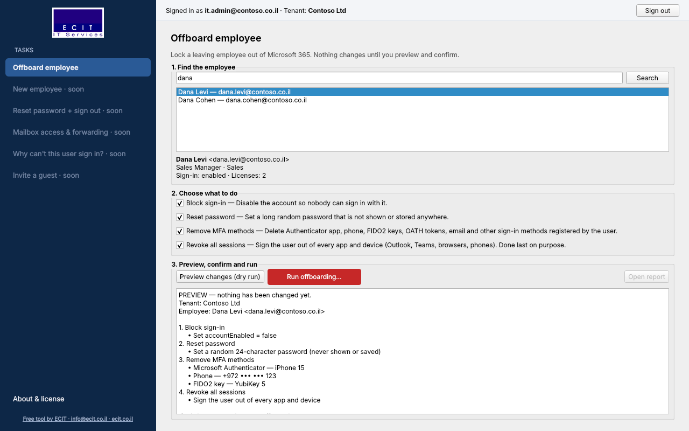

# ECIT Admin Console

Free desktop app that puts everyday Microsoft 365 admin jobs in one window: no more clicking
through five portals. Version 0.1 starts with the job that matters most for security:
**offboarding an employee**. By [ECIT IT Services](https://ecit.co.il).

> **Status: pre-release for testing.** Not announced yet.

## Download

| Platform | Download | Requirements |
|---|---|---|
| Windows | [ECIT-Admin-Console-0.1.0-setup.exe](https://github.com/eyal2005ai-rgb/ecit-admin-console/releases/download/v0.1.0/ECIT-Admin-Console-0.1.0-setup.exe) | Windows 10/11 64-bit, no admin rights needed |
| Mac (Apple silicon, M1 and later) | [ECIT-Admin-Console-0.1.0-mac-apple-silicon.dmg](https://github.com/eyal2005ai-rgb/ecit-admin-console/releases/download/v0.1.0/ECIT-Admin-Console-0.1.0-mac-apple-silicon.dmg) | macOS 11 or later |
| Mac (Intel) | [ECIT-Admin-Console-0.1.0-mac-intel.dmg](https://github.com/eyal2005ai-rgb/ecit-admin-console/releases/download/v0.1.0/ECIT-Admin-Console-0.1.0-mac-intel.dmg) | macOS 11 or later |

All versions: see Releases. SHA-256 checksums are attached to each release (`SHA256SUMS.txt`).

## What it does

**Offboard employee:** lock a leaving employee out of Microsoft 365 in one click.

- **Block sign-in:** disables the account
- **Reset password:** a long random password that is never shown or saved
- **Remove MFA methods:** Authenticator app, phones, FIDO2 keys, OATH tokens and other methods
- **Revoke all sessions:** signs the user out of every app and device (runs last)

Nothing changes until you preview it: every task shows a dry run, and you confirm by typing the
employee's email address. Every run saves a PDF audit report on your computer.

Coming next: mailbox and OneDrive handover, license removal, new employee, password reset and
sign-out, and "Why can't this user sign in?".

## One-time setup in your tenant

The app has **no built-in app registration**. You register it once in your own Microsoft Entra
tenant (about 5 minutes), then enter the Directory (tenant) ID and Application (client) ID under
**Connections…** in the app. MSPs add one connection per customer tenant.

- Step by step: [docs/SETUP_APP_REGISTRATION.md](docs/SETUP_APP_REGISTRATION.md) (also shown inside the app)
- Or run [docs/create-app-registration.ps1](docs/create-app-registration.ps1) as a Global Administrator

Delegated Microsoft Graph permissions only (the app can never do more than your own admin role):
`User.Read`, `User.Read.All`, `User.EnableDisableAccount.All`,
`User-PasswordProfile.ReadWrite.All`, `User.RevokeSessions.All`,
`UserAuthenticationMethod.ReadWrite.All`.

## Privacy

The app runs on your computer and talks only to Microsoft. Your sign-in stays in memory and is
gone when you close the app. Connections (IDs only) and audit reports are saved only on your
computer. ECIT receives nothing.

## First launch

The installers are not code-signed. On Windows click **More info → Run anyway**. On a Mac
right-click the app → **Open** (or System Settings → Privacy & Security → **Open Anyway**).

## License

Free to use under the End User License Agreement shown during installation
([resources/EULA.txt](resources/EULA.txt)). Not affiliated with Microsoft.
Questions: info@ecit.co.il

Building from source: [docs/DEVELOPER.md](docs/DEVELOPER.md).
